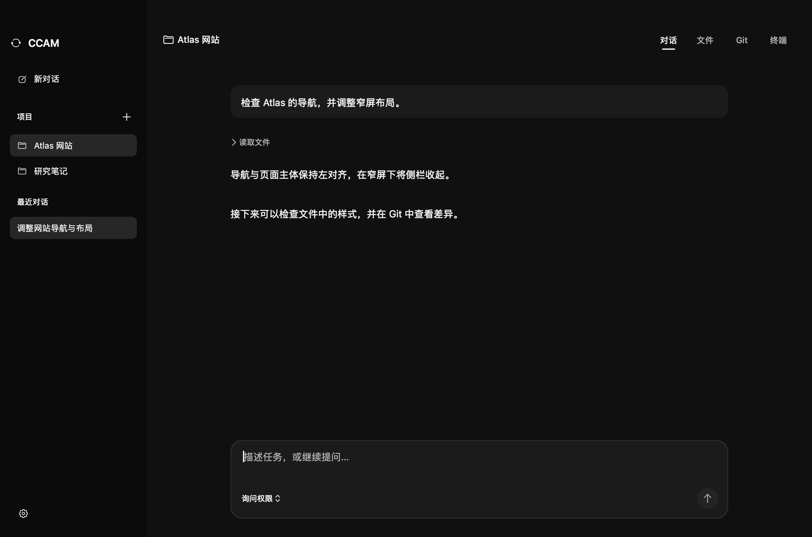
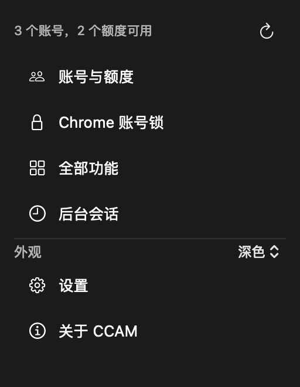
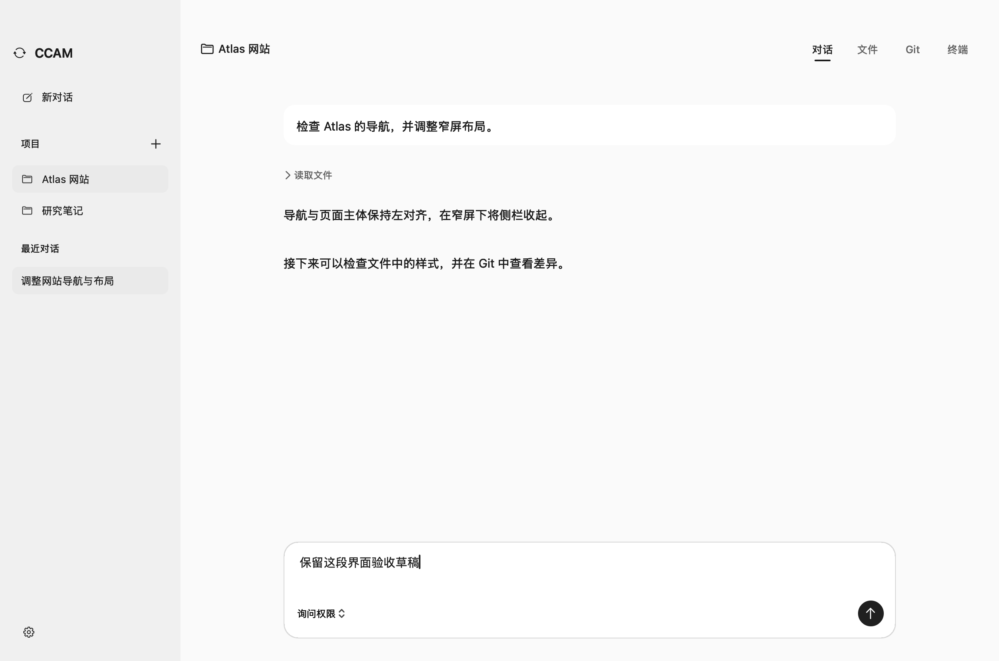

# CCAM Desktop

一个原生 macOS 工作台，把 CCAM 的账号管理、项目对话、文件、Git 和终端放在同一个窗口里。

**项目保存任务与上下文，账号管理额度。** 多个项目共用账号池；额度中断时，工作台通过 CCAM 的恢复票据换号续接原会话。

A native macOS workspace for CCAM, with account usage, project chat, files, Git, an embedded terminal, and quota-triggered session handoff.



## 能做什么

| 工作对象 | 功能 |
| --- | --- |
| 账号与额度 | 查看各账号额度与状态，添加、登录和管理账号；订阅账号组成全局池，项目不绑定固定额度。 |
| 连续对话 | 按项目保存历史；支持发送、停止、权限模式和草稿。额度中断后换号续接精确会话，保留目录、上下文与已有成果。 |
| Chrome 个人资料 | 为 CCAM 账号选择登录时使用的 Chrome 个人资料，可自由搭配、修改或解除绑定。 |
| 项目 | 添加文件夹、切换、重命名、归档和恢复。切换项目或工作区不会停止后台任务。 |
| 文件 | 浏览目录、编辑 UTF-8 文本、保存改动；检测外部修改，防止覆盖冲突。 |
| Git | 查看分支、改动和差异，按文件暂存或取消暂存，再提交已暂存改动。 |
| 终端 | 内置交互任务与开发终端；需要进一步交互时，可把图形对话移交到原会话的终端。 |
| 功能中心 | 7 类功能与搜索，提供 61 项可视化操作，覆盖适配版本的 67 项底层操作。 |

默认使用中性黑配色，也支持浅色和跟随系统。项目与对话保留在侧栏；账号、额度、外观和设置收进左下角齿轮。日常管理通过按钮完成，无需输入 CCAM 命令。



<details>
<summary>查看浅色界面</summary>



</details>

## 安装与开始使用

当前验证环境为 **Apple Silicon Mac、macOS 13 或更新版本**。构建脚本按当前机器架构编译，Intel Mac 尚未验证。

运行前需要自行安装：

- [CCAM](https://ccam.dev/zh-hans/docs/quick-start/)：当前适配并测试的版本为 **0.11.0**。
- Claude Code：已安装并可在本机运行。
- Git；使用浏览器资料绑定时，还需要安装对应浏览器。

从 [Releases](https://github.com/lilijq/ccam-desktop/releases/latest) 下载 `CCAM-Desktop-v2.1.0-macos-arm64.zip`，解压后把应用拖入“应用程序”。发行包使用本地 ad-hoc 签名，尚未经过 Apple 开发者签名和公证。

1. 打开应用，从左下角齿轮进入“账号与额度”，配置可用账号。
2. 添加项目文件夹，输入任务并开始对话。
3. 在顶部切换“对话 / 文件 / Git / 终端”，从侧栏继续历史对话。

可用 `⌘,` 打开管理菜单，`⌘ Return` 发送消息。若没有自动找到 CCAM，可在设置中选择其可执行文件。

左下角常驻并列显示当前账号与账号池总剩余，分别列出 5 小时和每周窗口；点击可展开账号面板。当前行显示百分比，总剩余以“份”显示：每个账号满额计为 1 份，再合计各账号剩余比例。它是账号额度的归一化汇总，不是 token 数或不同套餐间的等价容量。同邮箱账号保守合并，未知额度不算作零，缺失身份、部分缓存与旧缓存会明确提示。所有刷新只读取 CCAM 本机缓存，不连接 Claude，也不触发额度探针。

输入框下方可选择模型（默认、Sonnet、Opus、Haiku 或自定义 ID）与模式（默认、计划、Auto、允许编辑）。更多菜单包含思考强度，设置按对话保存并沿用到后续提问与换号续做。默认模式中需要交互授权的操作可转到终端确认；原生聊天不自动放宽权限。Auto 使用 CLI 的原生权限评估；如果服务返回实际模式不同，聊天会提示回退结果。计划模式先分析和规划，修改前确认。

回形针可多选图片和文件，也支持拖入文件、粘贴截图、预览与移除。附件草稿按对话保存，只有点击发送才交给 Claude。图片通过结构化图像内容发送；PDF、文档和代码文件使用独立的本机副本，Claude 可按任务读取。附件随会话和换号续做保留，历史附件失效时单独提示。当前产品限制：最多 10 个附件，图片每张 3 MB，文件每个及每批总计 20 MB。

每段对话右侧的菜单提供重命名、复制、Markdown 导出和删除。删除后可从“最近对话”旁的回收站恢复，不会删除项目文件或 Claude 原生会话。

参数依据本机 Claude Code 2.1.308 的定义及官方 [CLI 参数](https://code.claude.com/docs/en/cli-reference)、[模型配置](https://code.claude.com/docs/en/model-config) 和 [权限模式](https://code.claude.com/docs/en/permissions)。模型可用性与思考强度上限由所用服务决定；选择控件本身不发送请求。

## 换号续做如何工作

首次任务由全局账号池选择可用订阅账号。普通追问继续使用原账号和原会话；只有 CCAM / Claude Code 的结构化额度事件才会触发换号，普通网络错误不会触发接力。

恢复时沿用精确的会话标识和中断票据，并发送续做指令，不重复提交最初的任务提示。目录、已有文件和权限模式保留。接续过程仍遵守原任务范围与权限检查，不能把它理解为无需确认地重放所有操作。

额度中断后暂时没有可用账号时，每分钟重试，最多等待 5 小时，也可以停止。首次启动就没有可用账号时会直接提示。API 账号可手动使用，不进入这条订阅账号自动接力流程。

需要交互式权限确认时，可以选择“在终端继续”。移交后原图形对话变为只读，避免两个界面同时执行同一会话。

## Chrome 个人资料绑定

这里的“Chrome 账号”指浏览器右上角头像对应的**个人资料**。可将一个或多个 CCAM 账号关联到指定个人资料，用于本应用发起的登录。

系统允许时自动读取个人资料的名称和邮箱元数据；读取受限时，可以手动选择个人资料目录并填写显示名称。配置失效或本地启动设置覆盖了路由时，应用会停止并提示，不会静默改用另一个个人资料。

绑定只决定登录页面从哪个浏览器个人资料打开，不会更改其中的 Google 登录身份，也不约束外部终端发起的登录。应用不读取浏览器 Cookie、密码或登录凭据。

## 数据与边界

项目列表、浏览器绑定和图形对话保存在本机：

```text
~/Library/Application Support/CCAM Desktop/
├── projects.json
├── browser-locks.json
└── chats/
```

账号凭据、额度缓存与 Claude 原生会话仍由 CCAM / Claude Code 管理。工作台没有额外云端后台；执行模型任务时仍使用相应服务。

- 草稿在当前应用运行期间保留。重启可恢复已保存对话，但不会恢复原进程或内存中的终端输出。
- 文件编辑限于不超过 2 MB 的 UTF-8 文本；指向项目外部的符号链接不可编辑。
- Git 提交作用于所有已暂存改动。从子目录打开项目时，若存在范围外的暂存改动，会阻止提交并提示。
- 当前是 macOS 应用；窄窗口适配不代表提供 iOS 应用或手机远程网页。

## 从源码构建

安装 Apple Command Line Tools，并确保 CCAM 可用，然后在仓库根目录运行：

```sh
./build.sh
./test.sh
```

构建使用 Swift / AppKit、C PTY 桥接和仓库内的 SwiftTerm 源码，不需要 Node.js 或网页服务器。`build.sh` 在临时目录完成签名，再生成 `CCAM Desktop.app` 和不含扩展元数据的 `CCAM Desktop.app.zip`。位于云同步文件夹时，建议使用压缩包解压安装。设置 `CCAM_BUILD_COPY_APP=0` 可只生成压缩包，避免项目目录的应用副本出现在系统搜索中。

```text
Source/          原生界面、账号接力、浏览器路由、文件与 Git
Tests/           核心、集成与回归检查
Vendor/SwiftTerm  内置终端渲染器及其许可证
docs/            架构、截图与项目文档
```

实现结构见 [架构说明](docs/ARCHITECTURE.md)，贡献方式见 [贡献指南](CONTRIBUTING.md)。

## 验证范围

测试覆盖账号管理、项目存储、命令呈现、浏览器路由、PTY 生命周期、文件冲突、Git 操作及会话接力。集成测试在隔离的 `CCAM_HOME` 中运行真实 CCAM；自动换号与连续接续使用模拟 Claude 的额度事件验证，**不等同于真实模型或真实账号额度耗尽的线上验证**。

桌面布局、管理菜单、主题切换与草稿保留已通过离屏 AppKit 检查，以及实际可见窗口中的原生按钮回调检查。系统鼠标事件自动化和真实浏览器 OAuth 未完成验收。截图中的项目与账号均为隔离演示数据。

## 许可与来源

本项目采用 [MIT License](LICENSE)。SwiftTerm 1.9.0 也使用 MIT 许可证，保留其原始版权和许可声明；详见 [第三方说明](THIRD_PARTY_NOTICES.md)。

本项目是独立的第三方界面，与 CCAM、Anthropic 或 Claude Code 无官方隶属关系。项目工作区的能力组织参考了 [claudecodeui](https://github.com/siteboon/claudecodeui)，聊天、文件和 Git 界面以原生 Swift 独立实现，未引入该项目的源码、界面资源或网页后端。
