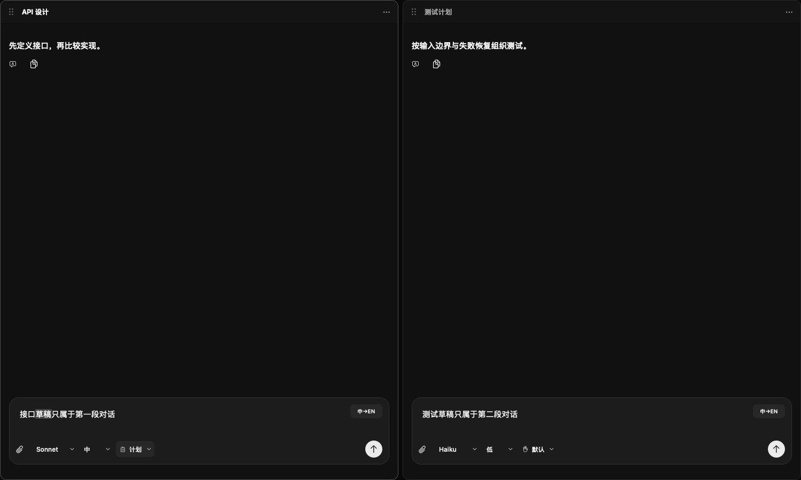
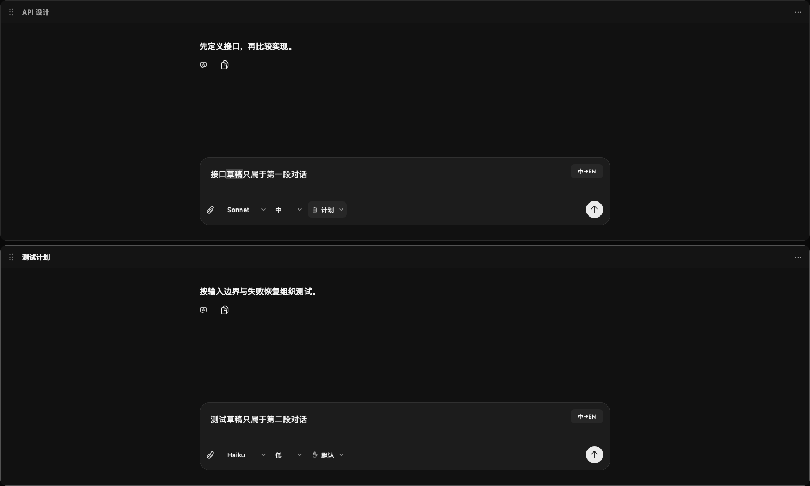

# 多对话工作台

## 方向

CCAM 的主要内容是正在推进的项目对话。窗口应该帮助用户同时阅读两段思路、比较结果、查看工具，而不是把所有内容做成厚重的控制面板。保留现代黑与清晰的拖动入口，将清晰度集中在真实的对话标题、活跃面板和输入区域。

| Token | 深色值 | 用途 |
| --- | --- | --- |
| 工作台 | `#090909` | 面板之间的留白 |
| 面板 | `#141414` | 面板标题底面 |
| 导航 | `#080808` | 左侧项目与图标栏 |
| 边界 | `#2A2A2A` | 圆角面板的轻边界 |
| 正文 | `#F5F5F5` | 标题与主要内容 |
| 次级 | `#A3A3A3` | 图标与次要文字 |

系统 SF 字体配中文系统回退，代码保留 SF Mono；项目名 14 pt medium，对话标题 13 pt semibold，工具 12 pt。保留已有正文阅读字号，不为了装更多窗口而缩小正文。

## 布局

工具入口使用有悬浮说明的图标按钮；标题左对齐。面板用 10–12 pt 圆角与 8–10 pt 间距分隔，不使用整条灰色高亮横线。标题只显示当前内容：对话用自己的名称，文件、Git、终端和网页用简短类型名称。活跃面板通过标题与细边界区分，次要动作放入菜单。

```text
┌ ● ● ●             可拖动主窗口                         ┐
│ 导航 │ project                 [聊][文][Git][终][网] [分屏] │
│      │ ╭────────────────────╮ ╭──────────────────────╮ │
│ ▾项目│ │ ⠿ API 设计       ⋯ │ │ ⠿ 测试计划         ⋯ │ │
│  对话│ │                    │ │                      │ │
│  对话│ │ 对话正文           │ │ 对话正文             │ │
│      │ │                    │ │                      │ │
│      │ │ 独立草稿           │ │ 独立草稿             │ │
│ ○当前│ ╰────────────────────╯ ╰──────────────────────╯ │
│ ○全部│                                                │
│ 设置 │                                                │
└──────┴────────────────────────────────────────────────┘
```

## 行为

- 同一项目最多同时显示四个面板，可以包含多个不同对话与工具。
- 对话菜单提供在右侧/下方打开；分屏菜单可以选择现有对话或创建新对话。
- 已打开的对话直接聚焦；同一对话只有一个内容视图与执行实例。
- 每个对话独立保留模型、权限模式、草稿、附件、翻译、运行状态；隐藏面板不会终止任务。
- 单独关闭一个面板不删除对话。项目切换与重启保留布局；无效或已删除的对话不会错误替换成另一段。
- 文件、Git、终端、网页继续优先在右侧打开或复用工具区域，避免覆盖正在并排阅读的对话。
- 小六点拖动图标保持 32×32 pt 的操作区域，边缘停靠、中心交换、Escape 取消；窄窗口保留已有布局并暂时聚焦一个面板。

## 设计复核

上一版每个窗格都重复“对话”选择器，并常驻放大、关闭和菜单，造成工具栏比内容更抢眼。这版以真实对话标题替代重复标签，圆角只用于独立可移动的面板，图标只承担操作，不增加装饰。黑色是用户明确选择；不引入霓虹色、渐变或额外统计卡片。

## 验收计划

离线验证两段对话的草稿、模型和附件互不串联；交替保存、流式记录与翻译元数据不相互覆盖；删除与恢复、布局迁移、拖动、关闭、项目切换和窄窗恢复正常。用隔离桌面实例检查双对话与混合工具布局，不请求 Claude。

## 已完成验收（2.13.0）

- 208 项聊天核心检查、667 项离线界面检查通过。并行任务使用隔离的模拟 Claude 进程，没有向 Claude 发送真实请求。
- 实际桌面中左右对话分别输入草稿，将右侧模型由 Haiku 改为 Opus，左侧仍为 Sonnet；收起侧栏后两份草稿继续保留。
- 打开文件形成三个面板，使用大拖动柄将右侧对话放到左侧下方，两个对话仍保留自己的草稿与模型。
- 从面板菜单关闭第二段对话，再通过侧栏“在下方打开”恢复，原草稿和 Opus 选择保留。
- 2.13.0（31）已构建、签名校验并更新到本机“应用程序”；旧版已备份，临时验收应用已清理。

下面是使用隔离记录渲染的双对话检查截图：





## 2.13.1 视觉微调

按使用反馈缩小并调淡六点拖动图标：圆点 2.5 pt，整体约 7.5×12.5 pt。保留 32×32 pt 操作区域，标题与拖动行为不变。
