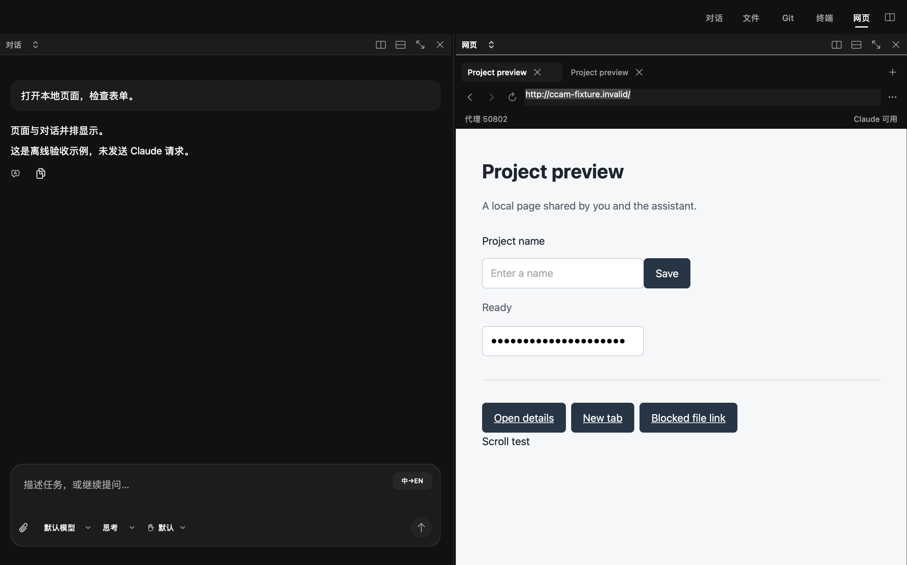
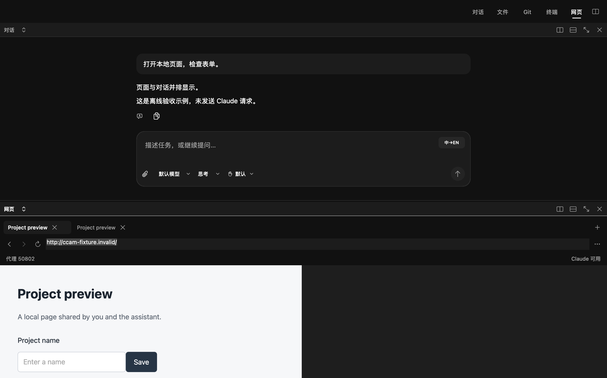

# 项目网页面板

## 视觉方向

CCAM 是本地开发工作台。网页是正在开发或检查的对象，界面应当把空间留给它，并让人看见 Claude 正在操作的同一个页面。

- 工作区黑 `#111111`、侧栏黑 `#080808`、工具面 `#1C1C1C`、边界灰 `#303030`、正文白 `#F5F5F5`、次要灰 `#A3A3A3`。状态色沿用全局 success / warning / danger，只表达状态。
- SF Pro / 系统中文字体：正文和地址 13 pt、标签和状态 12 pt；图标 14 pt。网页自己的字体和配色不被改写。
- 8 / 12 / 16 pt 间距；28 pt 图标按钮，36 pt 地址栏，紧凑横向标签。所有工具左对齐；右侧仅放控制状态。
- 桌面主布局：对话和网页左右并排，可使用现有系统上下分屏。窄窗格保留地址输入与操作入口。

```
项目                 对话 文件 Git 终端 网页  分屏
┌ 对话 ────────────────┬ 网页 ─────────────────┐
│                     │ 页面一  页面二    ＋   │
│ 回复正文             │ ‹ › ↻ [网址      ] …  │
│                     │ 代理 127.0.0.1:7897    │
│                     │                       │
│                     │ 同一个可交互网页       │
│                     │                       │
│ [输入框]             │                       │
└─────────────────────┴───────────────────────┘
```

复核：不新增浏览器仪表盘、彩色欢迎卡片或大段功能说明。空页面只提示输入网址，已保存页面只在明确打开/恢复时加载。沿用用户指定的现代黑风格，而非引入独立产品皮肤。设置继续集中在左下角；网页面板通过代理状态按钮进入同一个设置入口。

## 行为与边界

- WebKit 原生内嵌，项目独立数据存储和标签；不读取 Chrome 登录资料。
- macOS 14+ 的 WebKit 显式代理，使用全局 ExecutionProxy，禁止代理失败回退。macOS 13 显示不支持提示，不静默直连。
- 非 localhost 导航前检查代理 TCP 端口，失败立即取消。此检查不请求 Claude，也不代替 WebKit 的 CONNECT / TLS 验证。
- 全局代理改变立即停止加载并更新所有已有数据存储；没有有效配置则使用拒绝连接的配置并阻止导航。localhost / 127.0.0.1 / ::1 本地开发可访问。
- 只允许 HTTP(S) 导航；外部应用协议、任意本地文件、自动下载被拦截。新窗口进入本项目标签。
- Claude 通过本机 stdio MCP 桥接操控同一个视图，不创建第二个看不见的浏览器。工具只提供标签、导航、快照、点击、输入、滚动和截图；不提供任意脚本执行。
- 桥接使用私有 Unix socket 与随机认证令牌，项目单独绑定；配置不写进仓库。应用退出后连接失效。工具权限继续使用现有按项目记忆机制。
- 首次打开不联网；持久化地址不自动恢复访问。验收只使用本机测试页面和模拟代理，禁止 Claude 请求。

## 桌面验收





检查 1000 / 480 / 340 pt 网页宽度、左右与上下分屏，真实 WebKit 完成读取、输入、点击、滚动和截图；完整 stdio MCP 握手与调用、本机认证拒绝、过期元素引用、标签恢复以及代理不可用阻断均使用本机测试服务器验证。未发送 Claude 请求。

基础能力限制：主文档元素操作，不遍历跨域 iframe；不提供任意脚本执行、下载或文件上传工具。浏览器代理是应用网络配置，不是针对任意第三方代码的操作系统防火墙。
