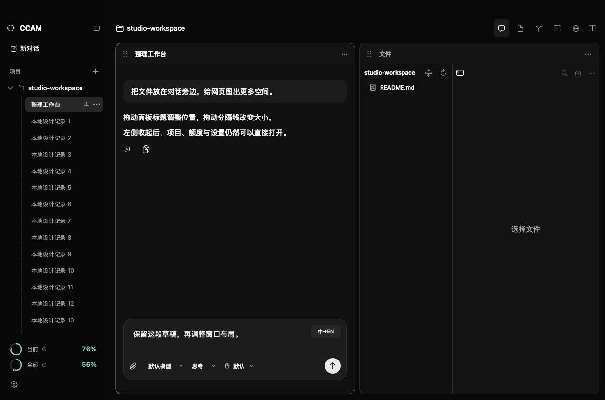
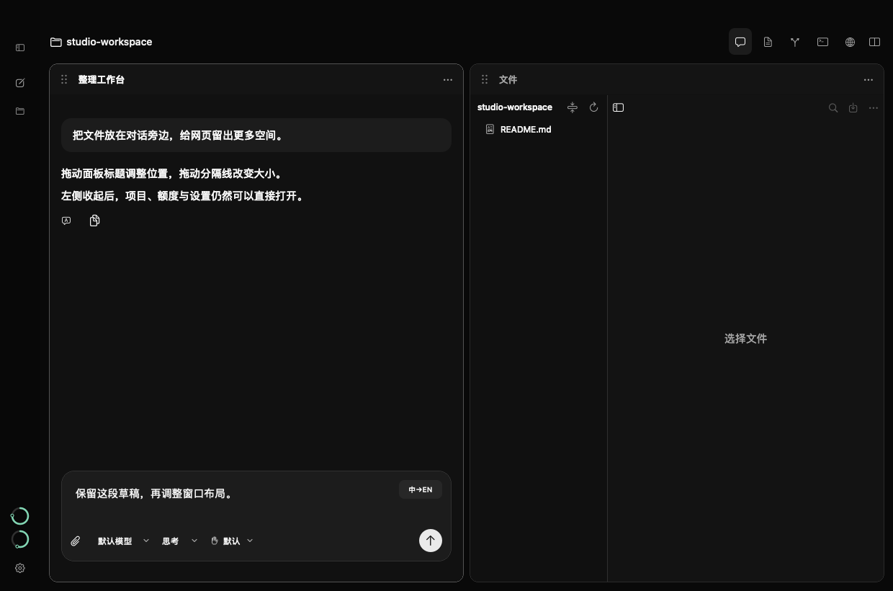
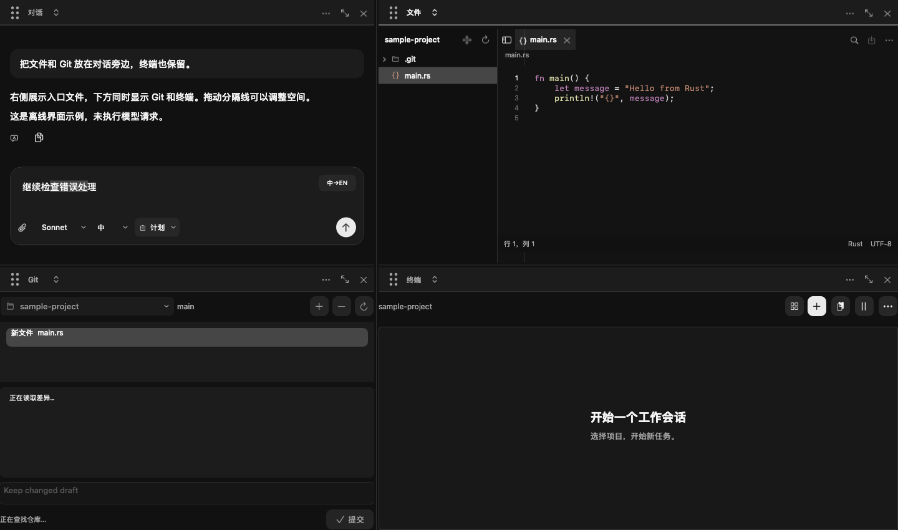

# 可整理的原生工作台

## 视觉方向

CCAM 是以对话为中心、需要同时观察代码与网页的 macOS 工作台。保留用户选择的现代黑，不引入装饰性卡片；把主要设计变化放在可拖动的面板与可收起的导航。

| Token | 值 | 用途 |
| --- | --- | --- |
| Canvas | `#111111` | 工作内容底色 |
| Rail | `#080808` | 项目导航 |
| Surface | `#1C1C1C` | 面板标题和输入区域 |
| Edge | `#303030` | 分隔线、边界 |
| Text | `#F5F5F5` | 正文与选中内容 |
| Muted | `#A3A3A3` | 次要按钮、状态 |

字体沿用 macOS SF 系统字体及中文系统回退；代码用 SF Mono。窗口标题 13 pt medium，面板工具 12 pt medium，正文沿用既有阅读字号。颜色通过现有 Theme 适配亮色模式。额度继续使用已有状态色，布局不新增强调色。

## 布局

内容左对齐。导航展开约 224 pt，手动收起为约 56 pt 图标栏；较窄窗口继续使用已有紧凑导航。间距采用 4/8/12/16，面板标题 40 pt，六点拖动柄区域 32×32 pt，拖动分隔线保持至少 7 pt 命中区域。

```text
展开
┌ ● ● ●    [收起] ───────── 可拖动窗口顶部 ──────────────┐
│ 新对话     │ parrot-ai           对话 文件 Git 终端 网页 │
│ 项目       ├─────────────────┬─────────────────────────┤
│ ▾ parrot-ai│ ⠿ 对话       ⋯  │ ⠿ 网页              ⋯  │
│   对话     │                 │                         │
│            │                 ├─────────────────────────┤
│ ○ 当前  %  │ 输入草稿        │ ⠿ 文件              ⋯  │
│ ○ 全部  %  │                 │                         │
│ 设置       │                 │                         │
└────────────┴─────────────────┴─────────────────────────┘

收起
┌ ● ● ● ────────────────────────────────────────────────┐
│ ▷ │ parrot-ai                     工作区工具           │
│ + ├──────────────────────┬────────────────────────────┤
│ ▣ │ ⠿ 对话            ⋯ │ ⠿ 网页                 ⋯  │
│   │                      │                            │
│ ○ │                      │                            │
│ ○ │                      │                            │
│ ⚙ │                      │                            │
└───┴──────────────────────┴────────────────────────────┘
```

## 交互

- 点击顶部「文件、Git、终端、网页」保留左侧对话，并在右侧打开工具；继续切换工具复用右侧区域。手动建立的复杂布局保留，已显示的面板直接聚焦。
- 标题栏的六点拖动柄直接绘制，避免系统符号缺失。整个标题栏空白区域同样可拖动。
- 标题栏拖动面板：目标边缘表示插入该方向，中心表示交换；释放前显示目标区域。
- 分隔线调整比例，布局继续按项目保存。按 Escape 或拖到工作区外取消，不改变布局。
- 标题栏提供菜单操作作为拖动的替代方式。移动复用同一内容视图，不重建任务、编辑器或网页。
- 窗口顶部空白区域用于移动整个 macOS 窗口，不把编辑器或输入框当拖动区域。
- 图标栏保留项目入口、额度与设置；悬浮显示含义；展开恢复原项目与对话位置。

## 设计复核

避免把五种内容重复包装成相同卡片。保留项目导航与内容面板两级结构，移除与拖动无关的装饰。相比自由漂浮且相互遮挡的画布，采用有明确落点的面板拖动，保留 macOS 原生主窗口移动与调整大小，方便持续阅读、输入和调试。

## 验收

使用隔离的本地对话、文件及网页内容检查：拖动换位、四方向排列、取消拖动、比例调整、导航收起展开、窄窗恢复，以及草稿与文件状态保留。不发送 Claude 请求。


## 桌面验收结果

版本 2.12.0（30）。611 项离线界面检查通过；在隔离桌面应用中实际拖动完成中心交换、下方停靠，确认输入草稿保留；逐一点击文件、Git、终端、网页，确认右侧工具区域复用；收起侧栏后可打开设置。未发送 Claude 请求或加载远程网页。

展开侧栏：



收起侧栏：



四个工作区面板：


